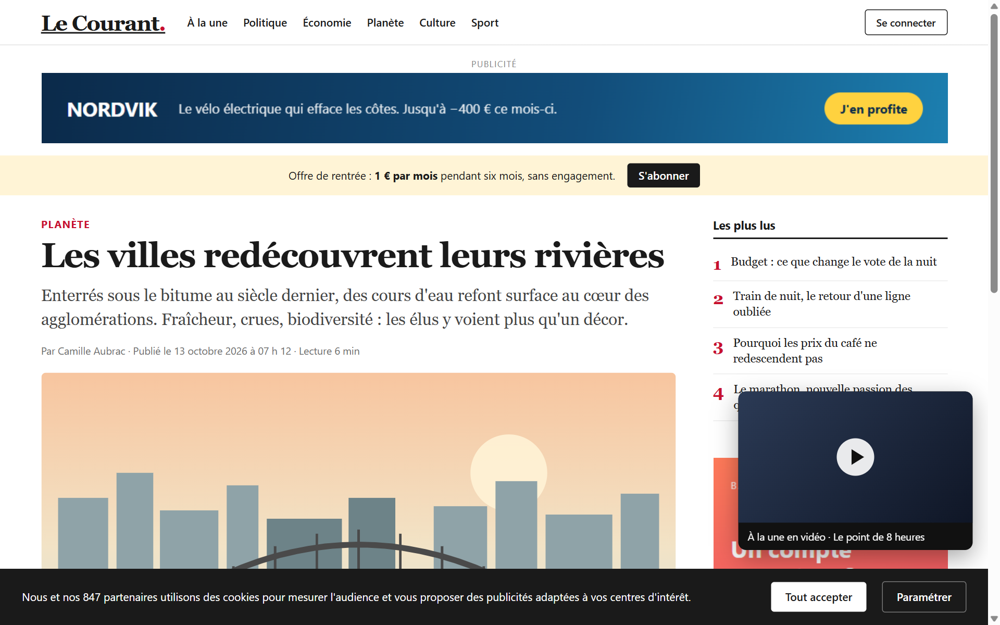
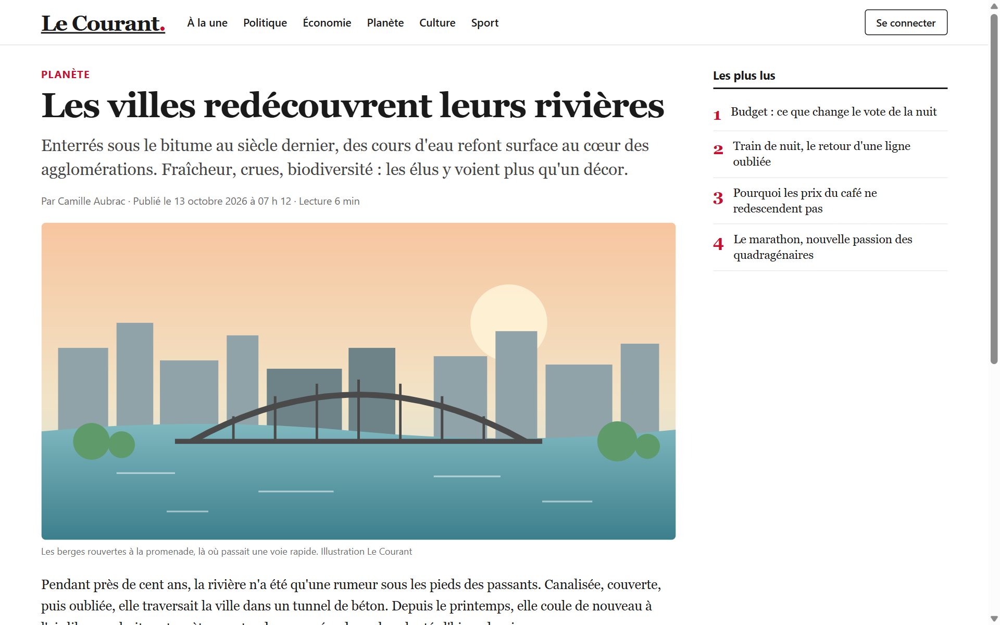
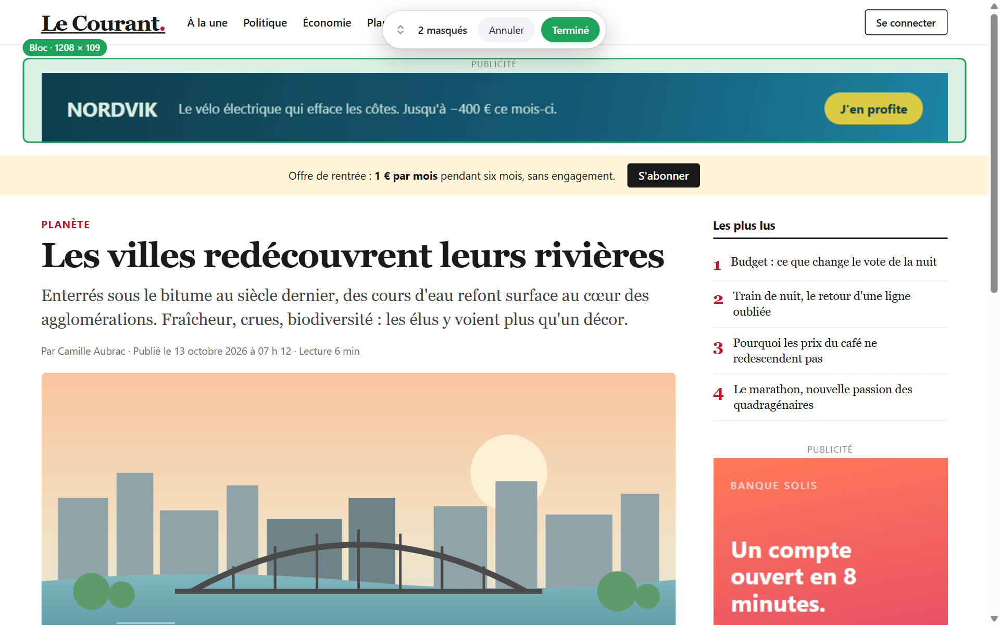
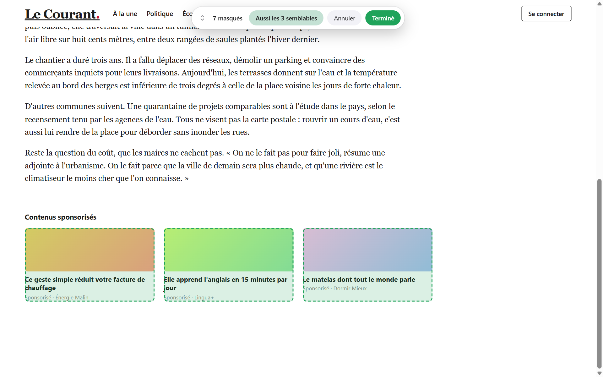
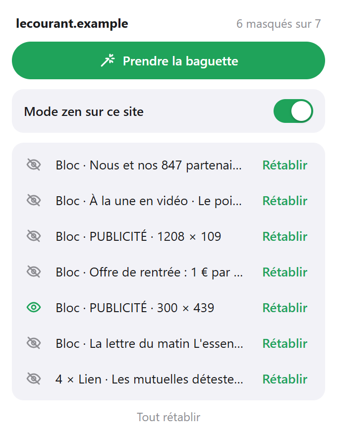

# Zen

A Chrome extension that hides what gets in the way on a website (an ad, a cookie bar, a floating video, a row of sponsored links) with one click, and keeps it hidden on every visit.

 

## What it does

- **The wand.** Click the toolbar button, then "Take the wand", or press `Alt+Shift+Z`. The block under the mouse is outlined in green; a click hides it. While the wand is in hand the page receives nothing: links are not followed and videos do not start.
- **It aims at the block you see.** Under the mouse there is often an invisible piece of a larger block: the text field inside a search bar, the text of a banner, an ad without its "Advertisement" label. Zen starts from the visible block. `↑` takes a wider block, `↓` a narrower one.
- **The similar ones.** After hiding a card or a row, the bar offers to hide the others like it. Hovering the button outlines them first.
- **It remembers, per site.** What you hid is hidden again at every visit, before the page is shown, including elements the site adds later.
- **The list.** The popup lists what is hidden on the current site. The eye next to each line shows that element on the page again (the page scrolls to it and outlines it), and hides it when clicked again. "Restore" forgets the line. A switch pauses Zen on the site without losing the list.
- **Undo.** `Ctrl+Z` brings back the last hidden block, `Esc` puts the wand down.
- **Scrolling comes back.** Removing a cookie wall often leaves the page unable to scroll; Zen unlocks it.

The interface follows the language of Chrome: English by default, French when Chrome is set to French. The site in the screenshots is made up for the demonstration.

## Install

The extension is not on the Chrome Web Store, so it is loaded by hand:

1. Download this repository (**Code**, then **Download ZIP**) and unzip it, or clone it.
2. Open `chrome://extensions` and turn on **Developer mode**.
3. Click **Load unpacked** and choose the folder.
4. Reload the tabs that were already open.

## How it works, and what that means

Each hidden element is saved as an address for its site (a CSS selector). At the start of every page, Zen reads the list for that site and turns it into one style rule per element. Nothing watches the page afterwards: the browser applies the rules by itself.

- **Finding the element again.** Many sites give their elements machine-made names that change at every update or every load. Zen ignores those, as well as names that only describe a look or a state (`flex`, `mt-4`, `active`), and prefers what developers wrote by hand: identifiers, `data-…` attributes, labels, the origin of an embedded frame. When an element has nothing of the kind, Zen falls back on its position in the page and marks the line "fragile": if the site reorganises its page, that rule can stop working or land on another block.
- **It hides, it does not block.** The ad is still downloaded and its scripts still run. Zen is not an ad blocker and detects nothing by itself: it only hides what you clicked.
- **Frames from other sites.** An ad or a video player that comes from another site can be hidden as a whole, not piece by piece.
- **Protected pages.** Chrome does not let extensions change its own pages or the Chrome Web Store.
- **Cost.** The script that runs on every page takes about 0.1 ms. The page is held invisible until the site's list has been read, which measured as at most one screen frame, and never more than 150 ms.

## Privacy

Everything stays in the browser's local storage. Zen has no server and makes no network request. For each hidden element it keeps the address described above and a short label (the first words of the element's text) so the list is readable.

| Permission | Why it is needed |
| --- | --- |
| A script on every `http` and `https` page | Hide, at each visit, what you hid on that site. This is why Chrome says the extension can read and change data on all sites |
| `storage` | Keep the list of hidden elements for each site |
| `activeTab` and `scripting` | Put the wand in the current tab when you ask for it |

## License

[MIT](LICENSE) © 2026 Yanis Arris
